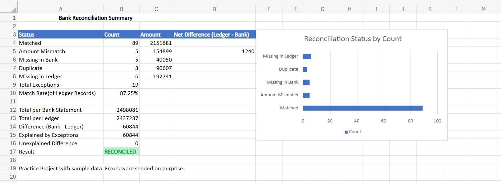
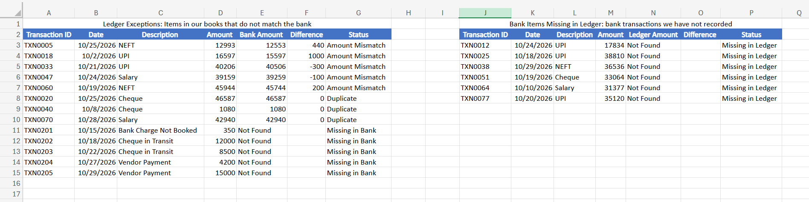

# Bank Reconciliation Workbook (Excel)

## About
An Excel workbook that reconciles a bank statement against a company ledger. Each entry is
matched with XLOOKUP and classified, and unmatched items are listed in an Exceptions sheet
with a Probable Reason for follow-up.

## What it does
- Matches 100+ bank statement and ledger transactions in both directions using XLOOKUP
- Classifies every entry as Matched, Amount Mismatch, Missing in Bank, Missing in Ledger or Duplicate
- Summarises count, amount and net difference per status using COUNTIF and SUMIFS, with a chart
- Lists all exceptions in one sheet, with a Probable Reason dropdown (e.g. data entry error)
- Checks that the difference between bank and ledger is fully explained by the exceptions
  (shows RECONCILED or CHECK)

## Sheets
- Bank_Statement : bank-side transactions with match status
- Ledger : company ledger with match status
- Summary : status-wise counts, amounts, net difference and chart
- Exceptions : unmatched items for follow-up

## Tools
Microsoft Excel (XLOOKUP, COUNTIF, SUMIFS, Data Validation, Conditional Formatting, Charts)

## Screenshots

## How to open
Download Bank_Reconciliation.xlsx and open it in Excel 2021 or Microsoft 365
(XLOOKUP is not supported in older versions).

## Note
Practice project with sample data. No real bank or customer information.